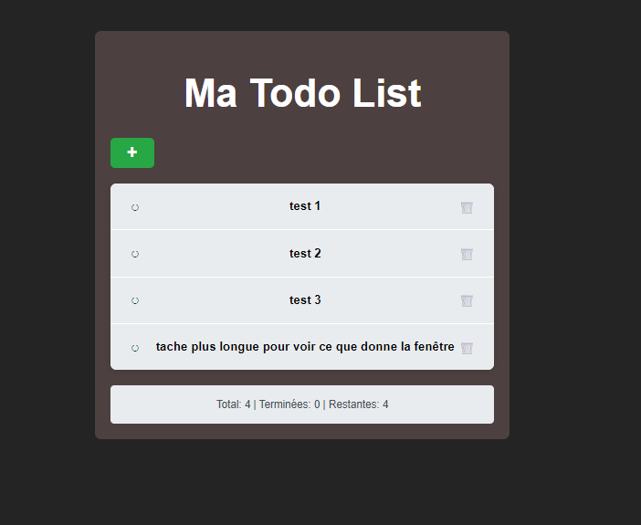

# 🐳 Projet_Kubernetes

## Objectif du projet
Ce projet a pour objectif de **me former à Docker et Kubernetes** à travers plusieurs mini-projets pratiques, illustrant la **création, la conteneurisation et le déploiement d’applications web** simples et complètes.

---

## 1. Initiation à Docker

### But
Découvrir les principes fondamentaux de Docker : création d’une image, conteneurisation d’une API simple et exécution d’un service dans un environnement isolé.

### Contenu
Le dossier **Hello-docker** contient une première application Flask minimale :

- **`app.py`** : API permettant d’afficher `"Hello"` à la racine (`/`), accessible sur le port **5000**.  
- **`Dockerfile`** : copie une image Python de base, ajoute les fichiers nécessaires et lance le script `app.py`.  
- **`requirements.txt`** : installe le module **Flask**, requis pour exécuter l’API.

### Résultat
Exécution d’une application Flask contenue dans une image Docker légère.  
Cette étape constitue la base de la compréhension de la création et du lancement de conteneurs.

---

## 🌦️ 2. Mini-projet : Affichage météo selon la position

### Objectif
Créer une petite application web permettant d’afficher la météo selon la **position géographique actuelle** de l’utilisateur, et de l’exécuter dans un conteneur Docker.

### Description
- Utilisation du **framework Bootstrap** pour la mise en page.  
- Consommation de l’**API REST OpenWeatherMap** pour récupérer les données météo.  
- Si la position de l’utilisateur est accessible, l’application affiche la météo locale. Sinon, elle affiche celle de **Paris** par défaut.

### Exemple


---

## 3. Gestionnaire de tâches (ToDo App)

### Objectif
Créer une **application complète** (frontend + backend + base de données) et l’exécuter à l’aide de **Docker**.  
Ce projet met en pratique la séparation des services dans différents conteneurs et la communication entre eux.

### Architecture du projet

- **Frontend :** React ou Vue.js  
- **Backend :** Flask (Python)  
- **Base de données :** SQLite  
- **Orchestration :** Docker (images et conteneurs distincts)

### Structure générale

```
ToDoApp/
│
├── backend/
│   ├── app.py
│   ├── requirements.txt
│   ├── Dockerfile
│   └── tasks.db
│
├── frontend/
│   ├── package.json
│   ├── src/
│   ├── public/
│   └── Dockerfile
│
└── docker-compose.yml
```

---

### 🧠 Fonctionnement du backend (Flask)

API REST Flask gérant les tâches :

- `GET /tasks` → Récupère la liste des tâches  
- `POST /tasks` → Ajoute une nouvelle tâche  
- `PUT /tasks/<id>` → Modifie une tâche  
- `DELETE /tasks/<id>` → Supprime une tâche  

**Exemple de code :**
```python
from flask import Flask, request, jsonify
import sqlite3

app = Flask(__name__)

@app.route('/tasks', methods=['GET'])
def get_tasks():
    conn = sqlite3.connect('tasks.db')
    cursor = conn.cursor()
    cursor.execute("SELECT * FROM tasks")
    tasks = cursor.fetchall()
    conn.close()
    return jsonify(tasks)
```

---

### Étapes de mise en place

#### Étape 1 — Création et test du backend
- Création du fichier `app.py` et du fichier `tasks.db`.  
- Test local avec Flask pour vérifier le bon fonctionnement de l’API.

#### Étape 2 — Dockerisation du backend
- Écriture d’un **Dockerfile** :
```dockerfile
FROM python:3.9
WORKDIR /app
COPY . .
RUN pip install -r requirements.txt
CMD ["python", "app.py"]
```
- Construction de l’image :
```bash
docker build -t todo-backend .
```
- Lancement du conteneur :
```bash
docker run -p 5000:5000 todo-backend
```

#### Étape 3 — Création et dockerisation du frontend
- Initialisation d’un projet React :
```bash
npx create-react-app todo-frontend
```
ou Vue :
```bash
npm init vue@latest
```

- Ajout des dépendances et connexion à l’API Flask.

#### Étape 4 — Intégration et déploiement via Docker Compose
- Création du fichier `docker-compose.yml` pour orchestrer les conteneurs :
```yaml
version: "3.9"
services:
  backend:
    build: ./backend
    ports:
      - "5000:5000"
  frontend:
    build: ./frontend
    ports:
      - "3000:3000"
    depends_on:
      - backend
```
- Lancement simultané :
```bash
docker-compose up --build
```

---

### Résultat final

**Interface frontend (Vue / React)** affichant la liste des tâches :

- Ajout d’une nouvelle tâche  
- Suppression d’une tâche  
- Marquage d’une tâche comme terminée  

**Exemple d’interface :**



---

## 4. Orchestration complète : Docker Compose multi-services

### Objectif
Lancer simultanément les **trois grands services du projet** (Méteo, Backend, Frontend) en une seule commande avec **Docker Compose**.

### Architecture globale

```
Utilisateur
    ↓
[Frontend - Port 5173]  (React/Vue - Node)
    ↓
[Backend - Port 5000]   (Flask - Python)
    ↓
[Méteo - Port 4000]     (Flask - Python)
```

### Configuration Docker Compose

Créez un fichier **`docker-compose.yml`** à la racine du projet avec la configuration suivante :

```yaml
version: "3.9"

services:
  # Service Météo
  meteo:
    build:
      context: ./docker/meteo-docker
      dockerfile: dockerfile
    container_name: meteo-service
    ports:
      - "4000:4000"
    environment:
      - FLASK_ENV=production
    restart: unless-stopped

  # Backend - API Flask (Gestionnaire de tâches)
  backend:
    build:
      context: ./docker/ToDo_app/backend
      dockerfile: dockerfile
    container_name: backend-service
    ports:
      - "5000:5000"
    environment:
      - FLASK_ENV=production
    volumes:
      - ./docker/ToDo_app/backend:/backend
    depends_on:
      - meteo
    restart: unless-stopped

  # Frontend - React/Vue
  frontend:
    build:
      context: ./docker/ToDo_app/frontend/frontend
      dockerfile: dockerfile
    container_name: frontend-service
    ports:
      - "5173:5173"
    environment:
      - VITE_API_URL=http://localhost:5000
    volumes:
      - ./docker/ToDo_app/frontend/frontend:/app
      - /app/node_modules
    depends_on:
      - backend
    restart: unless-stopped
```

### Accès aux services

Une fois lancés, accédez à :

| Service | URL | Port |
|---------|-----|------|
| 🌦️ **Météo** | [http://localhost:4000](http://localhost:4000) | 4000 |
| 📋 **Backend API** | [http://localhost:5000](http://localhost:5000) | 5000 |
| ⚛️ **Frontend** | [http://localhost:5173](http://localhost:5173) | 5173 |

### Commandes de lancement

#### Démarrer tous les services
```bash
docker-compose up --build
```

#### Démarrer en arrière-plan
```bash
docker-compose up -d --build
```

#### Arrêter tous les services
```bash
docker-compose down
```

#### Voir les logs en temps réel
```bash
docker-compose logs -f
```

#### Voir les logs d'un service spécifique
```bash
docker-compose logs -f frontend
docker-compose logs -f backend
docker-compose logs -f meteo
```

#### Reconstruire les images (utile après modifications)
```bash
docker-compose build
```

### Ordre de démarrage

Docker Compose respecte l'ordre des dépendances :
1. **Méteo** démarre en premier
2. **Backend** attend que Méteo soit prêt
3. **Frontend** attend que Backend soit prêt

Cet ordre garantit que tous les services de communication sont disponibles.

---

## Compétences techniques mises en œuvre

| Domaine | Technologies |
|----------|---------------|
| **Conteneurisation** | Docker, Docker Compose |
| **Backend** | Flask, Python, SQLite |
| **Frontend** | React, Vue.js, HTML, CSS, JavaScript |
| **Orchestration (à venir)** | Kubernetes |
| **API REST** | Méthodes CRUD, communication client-serveur |
| **DevOps / CI** | Construction d’images, gestion de versions |
| **Outils & Environnement** | VS Code, GitHub, Docker Hub |

---

## Conclusion

Ce projet m’a permis de :
- Comprendre le cycle complet de **développement et conteneurisation** d’une application.  
- Expérimenter la communication entre services **frontend**, **backend** et **base de données**.  
- Préparer la prochaine étape : **le déploiement de ces conteneurs sur Kubernetes**.
